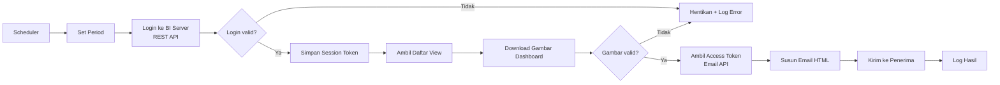

# Otomatisasi Pengiriman Ringkasan Dashboard Keuangan Bulanan

> Pipeline otomatis yang mengambil dashboard dari Tableau lewat REST API dan mengirimkannya sebagai ringkasan email ke seluruh kepala cabang, tanpa proses manual.

**Peran:** Data Analyst
**Periode:** Otomatis diambil per bulan di tahun berjalan
**Teknologi:** Talend 8.0.1, Tableau REST API, OAuth 2.0 / token-based email API, JSON

> ⚠️ Seluruh nama, URL, angka, dan data pada repositori ini adalah **dummy**. Tidak ada data atau kredensial perusahaan.

---

## 1. Latar belakang dan masalah

Setiap bulan, ringkasan kinerja keuangan perlu sampai ke kepala cabang. Prosesnya sebelumnya manual:

- Dashboard dibuka, di-screenshot, lalu ditempel ke email satu per satu.
- Rawan salah kirim, salah periode, atau terlambat.
- Memakan waktu 2–3 jam setiap bulan dan bergantung pada satu orang.

## 2. Solusi

Membangun pipeline yang berjalan otomatis setiap periode:

1. Menentukan periode laporan secara dinamis.
2. Login ke Tableau Server via REST API dan menyimpan session.
3. Mengambil daftar view dan menemukan dashboard target.
4. Mengunduh dashboard sebagai gambar dan memvalidasi hasilnya.
5. Mengambil access token untuk email API.
6. Menyusun isi email (HTML + gambar) dan mengirimkannya ke daftar penerima.
7. Mencatat hasil eksekusi ke log.

## 3. Arsitektur



## 4. Tantangan dan cara mengatasinya

| Tantangan | Solusi |
|---|---|
| Session dan token kedaluwarsa | Alur login dan token dipisah dan dijalankan tiap eksekusi, lalu disimpan di context/variabel runtime |
| Gambar dashboard kosong atau gagal render | Validasi ukuran dan isi respons sebelum email dikirim |
| Periode laporan berganti tiap bulan | Komponen `Set_Period` yang menghitung periode otomatis |
| Kredensial tidak boleh hardcode | Seluruh secret dipindah ke context variable / environment variable |
| Kegagalan di tengah proses | Alur `OnSubjobOk` / `OnComponentOk` dan logging agar mudah ditelusuri |

## 5. Hasil

- Proses manual diganti pipeline otomatis untuk **35 penerima** setiap bulan.
- Estimasi penghematan waktu: **2–3 jam/bulan**.
- Mengurangi risiko salah kirim dan keterlambatan.
- Pelaksanaan terpantau lewat log eksekusi.

## 6. Demo (data dummy)

Versi demo dibangun ulang di Talend dari nol, memakai sandbox Tableau Cloud milik sendiri (data sample **Superstore**) dan inbox uji (Mailtrap), jadi tidak menyentuh aset kantor.

```
demo/
├── talend_job/            # export job demo (sudah dibersihkan, context kosong)
├── screenshots/           # tampilan job dan hasil email (dummy)
├── context.example.txt    # daftar variabel context, TANPA nilai asli
└── sample_output/         # gambar dashboard dan email contoh (dummy)
```

**Komponen utama job:**

| Tahap | Komponen Talend |
|---|---|
| Set periode | `tJava` / `tSetGlobalVar` |
| Login BI server | `tREST` + `tExtractJSONFields` |
| Ambil daftar view | `tREST` |
| Download gambar | `tHTTPRequest` / `tREST` |
| Validasi | `tJava` + `Run if` |
| Susun dan kirim email | `tJava` + `tSendMail` (SMTP uji) |
| Logging | `tLogRow` / `tLogCatcher` |

**Context variable:**

```
bi_server_url  
bi_site_name   
bi_pat_name   
bi_pat_secret   
smtp_host      
mail_to        
```

**Menjalankan demo:**

1. Import job lewat *Import items* di Talend Studio.
2. Isi nilai context dengan akun sandbox milik sendiri.
3. Jalankan job, lalu cek email di inbox Mailtrap.


## 7. Pelajaran

- Memisahkan konfigurasi dari logika membuat pipeline mudah dipindah antar environment.
- Validasi di setiap tahap lebih murah daripada memperbaiki email yang sudah terkirim.
- Dokumentasi alur membantu orang lain melanjutkan pekerjaan.

## 8. Kontak

Aditya Virgiansyah · https://www.linkedin.com/in/adityavirgiansyah/ · adityavirgiansyah3@gmail.com
